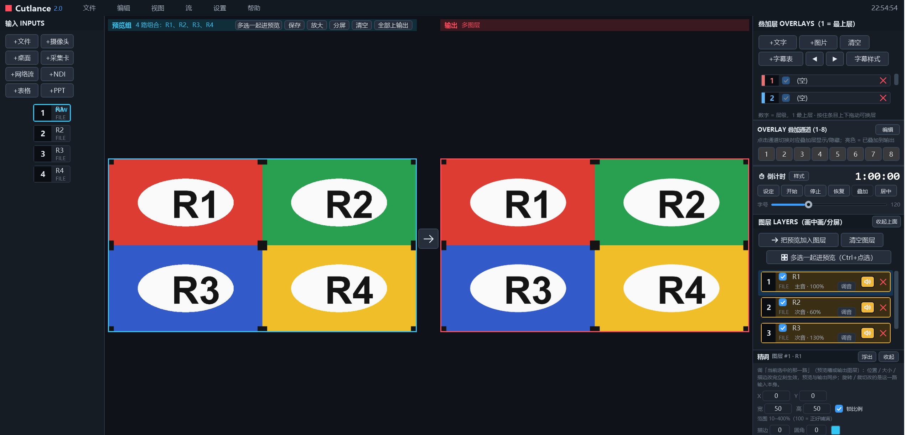
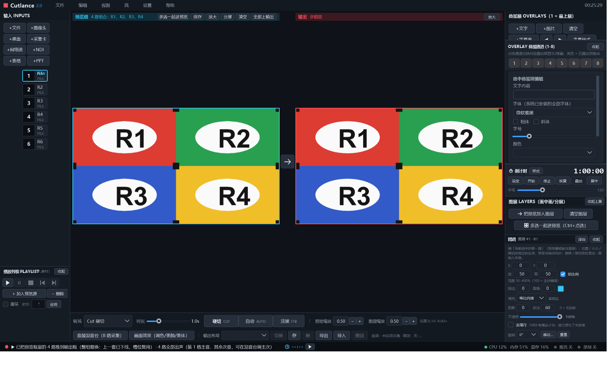
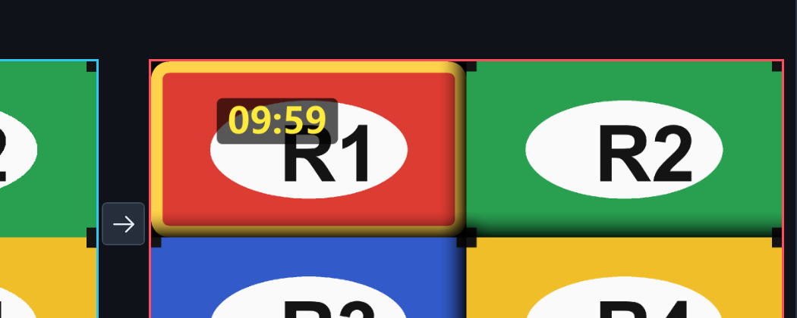
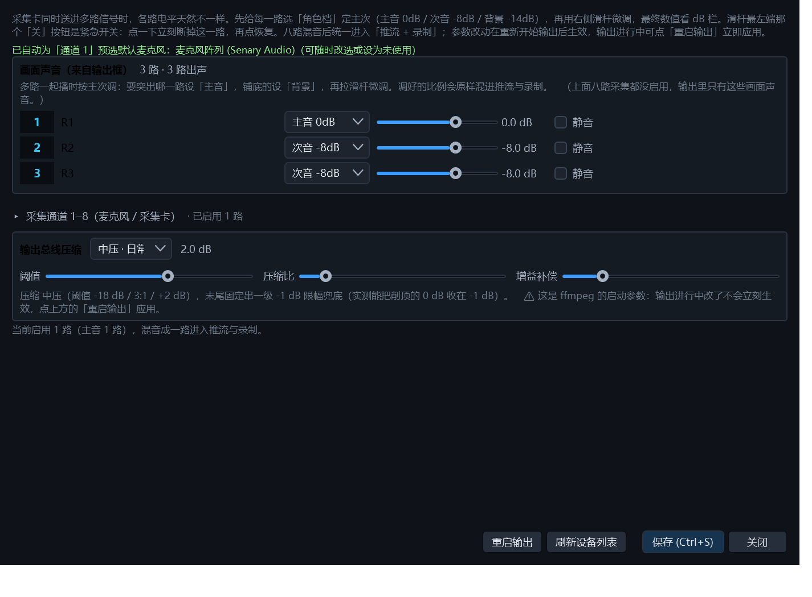
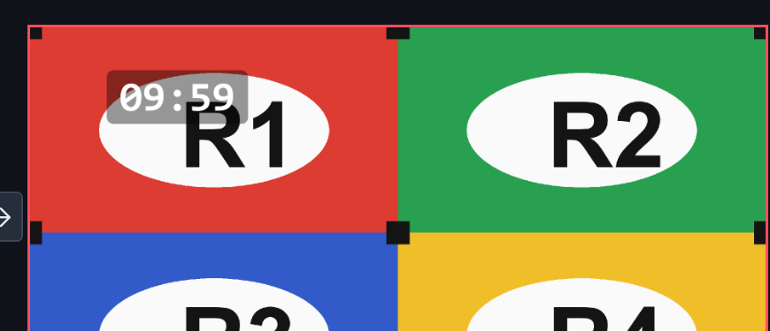

# Cutlance

> 面向直播导播的开源软件：多路画面切换、内存合成、推流与录制一体。
> Windows / C# / WPF / .NET 8 / LibVLC

Cutlance 是一个自研的直播导播台。它把「多路视频输入 → 画面合成 → 推流 / 录制 / NDI / 全屏输出」整条链路做在一个进程里，导播可以在一个界面上完成信号切换、分屏布局、音频混音与叠加元素的位置调整。

功能设计对标 vMix 28 的核心能力，并在若干实际使用场景上做了自己的取舍（见下方「与 vMix 的差异」）。



---

## 目录

- [核心特性](#核心特性)
- [技术架构](#技术架构)
- [快速开始](#快速开始)
- [依赖与第三方许可](#依赖与第三方许可)
- [项目结构](#项目结构)
- [质量保证](#质量保证)
- [与 vMix 的差异](#与-vmix-的差异)
- [已知限制](#已知限制)
- [路线图](#路线图)
- [参与贡献](#参与贡献)
- [许可证](#许可证)

---

## 核心特性

### 画面

| 能力 | 说明 |
|---|---|
| **内存合成输出** | 成品帧在内存里合成，推流 / 录制 / NDI / 全屏 / 监看**共享同一份像素**，不靠抓屏。主界面被遮挡、最小化都不影响输出画面 |
| **多路输入** | 本地文件、摄像头、采集卡、桌面捕获、PPT 放映窗口、网络流、NDI 源 |
| **多路分屏** | 支持 4 路 / 6 路 / 8 路等多种槽位布局；可整组切换（CUT / AUTO），也可只替换某一格 |
| **图层控制** | 每格独立的位移、缩放（锁宽高比）、层级、不透明度、描边（粗细 / 圆角 / 颜色）、阴影（扩散 + 浓淡） |
| **转场** | 直切 CUT、交叉溶解、淡入淡出（淡到黑）、淡黑到画面（FTB）；转场与 FTB 全做在成品帧上，观众看到的就是效果本身 |
| **异形屏输出** | 自定义任意分辨率（如 3840×1080 超宽 LED）；每格可选「等比内接 / 铺满裁切 / 拉伸铺满」 |
| **去隔行** | 1080i 隔行源按需启用 yadif 场插值，逐行素材可保持关闭（默认关，避免糊掉垂直细节） |



描边与阴影画在**成品帧**上（不是界面取景框的装饰），因此推流端、录制文件、NDI、全屏 HDMI 上都能看到：



### 音频

- **八路采集通道** + **画面声音通道**（输出框里正在播的每一路输入都会自动进入混音台）
- **角色档**：主音 0 dB / 次音 −8 dB / 背景 −14 dB，单路音量在此基础上微调
- **逐路压缩** + **输出总线压缩**：每路先压缩限幅再混音，总线再做最后一道防削顶
- 推流与录制共用同一路混音结果



### 输出

- **推流**：RTMP / RTMPS
- **录制**：本地录制，支持按时长分段（边界切关键帧），停止时自动清理不完整的尾段
- **NDI 输出**：局域网内被其它 NDI 接收端订阅
- **HDMI 全屏输出**：独立 STA 线程 + 独立 Dispatcher，主界面卡顿不会拖累副屏画面
- 硬件编码：NVENC / QSV / AMF，可按机器选择软编回退

### 导播辅助

- **倒计时牌**：叠加进输出画面，可自由拖动位置，字体 / 粗细 / 斜体 / 字色 / 底板可自定义；归零后继续走负数（红字）直到手动停止
- **布局预设**：把画面几何、层级、描边阴影、透明度、填充方式、每格音量角色、混音通道、压缩档一次性存成预设，直播中整套切换
- **工程文件**：完整保存「整张台面」——输入源、预览排列、输出槽位、音频、压缩、倒计时牌样式、界面状态；重开即回到上次现场



---

## 技术架构

### 为什么自己做合成器

常见做法是「窗口截图 → 编码」。这条路有三个绕不过去的问题：主界面被遮挡 / 最小化就断流、抓屏有额外延迟、多路叠加只能靠 WPF 视觉树拼（画面效果无法进入输出）。

Cutlance 改成**内存帧合成**：

```
多路解码（LibVLC / ffmpeg）
        ↓  BGRA 帧
   ┌────────────────┐
   │   Compositor   │  图层混合 → 描边/阴影 → 叠加层 → 转场旧帧 → FTB
   └────────────────┘
        ↓  一帧成品（1920×1080 BGRA）
   MonitorBridge（swap 后锁内分发）
        ↓
   ┌────────┬────────┬────────┬────────┐
   FFmpeg   FFmpeg   NDI      HDMI 全屏
   推流     录制     Sender   独立线程
```

关键设计：

- **单一成品帧**：所有输出线消费同一帧，不会出现「推流和录制画面不一致」
- **合成顺序固定**：图层 → 描边阴影 → 叠加元素 → 转场旧帧 → FTB，新效果按序插入即可
- **混合用直通 alpha**：`out = src×a + dst×(1−a)`，避免预乘公式用错导致的发白
- **音频不阻塞合成**：解码 → 混音总线 → 每路独立写线程 + 队列，混音线程绝不直接写设备

### 技术栈

| 层 | 选型 |
|---|---|
| UI | WPF（.NET 8）+ 自绘深色主题 |
| 视频解码 | LibVLCSharp 3.9 + LibVLC 3.0（文件 / 摄像头 / 网络流 / 桌面捕获） |
| 视频编码 / 封装 | 外部 ffmpeg（rawvideo 管道输入，编码器可选 NVENC / QSV / AMF / libx264） |
| 音频 | 采集设备 + 内存混音总线 + ffmpeg `amix` / `acompressor` / `alimiter` |
| 网络输出 | NDI（官方 SDK 托管包装）+ RTMP |
| 部署 | 自包含发布（win-x64）+ 独立安装器 / 卸载器 |

---

## 快速开始

### 环境要求

- Windows 10 / 11（x64）
- [.NET 8 SDK](https://dotnet.microsoft.com/download/dotnet/8.0)
- [ffmpeg](https://ffmpeg.org/download.html)（**不含在仓库内**，需自行安装）
- 可选：[NDI Runtime](https://ndi.video/tools/)（只用 NDI 输出时才需要）
- 可选：VLC 3.0.x（仅摄像头采集需要补一个 DirectShow 插件，见下）

### 构建

```bat
git clone <repo-url> Cutlance
cd Cutlance\vMixLite

dotnet restore
dotnet build -c Debug
start "" bin\Debug\net8.0-windows\Cutlance.exe
```

或在仓库根直接双击 `build.cmd`（一键还原 + 编译 + 启动）。

发布自包含版本：

```bat
dotnet publish vMixLite\Cutlance.csproj -c Release -r win-x64 --self-contained -o dist\Cutlance
```

### 让程序找到 ffmpeg

程序按以下顺序查找 ffmpeg：

1. 环境变量 `CUTLANCE_FFMPEG`（可指向 `ffmpeg.exe`，也可指向它所在目录）
2. 常见安装目录（`C:\FFMPEG\bin` 等）
3. 系统 `PATH`

推荐做法：把 ffmpeg 解压到任意目录，然后把该目录加入 `PATH`。

### 准备 VLC dshow 插件（仅摄像头采集需要）

`VideoLAN.LibVLC.Windows` NuGet 包不带 DirectShow 采集插件，缺它摄像头会报 `unable to open the MRL`。
从本机已安装的完整版 VLC 3.0.x 复制（**该二进制不入仓库**）：

```
<你的VLC安装目录>\plugins\access\libdshow_plugin.dll
        ↓
vMixLite\vlc-extras\plugins\access\libdshow_plugin.dll
```

编译时会自动复制到输出目录的 `libvlc\win-x64\plugins\access\`。

---

## 依赖与第三方许可

本仓库**只包含源码**，不包含任何第三方二进制，也不内置 ffmpeg 与 NDI 原生运行库。

| 组件 | 用途 | 许可 | 仓库内是否包含 |
|---|---|---|---|
| [LibVLCSharp](https://github.com/videolan/libvlcsharp) | 视频解码托管绑定 | LGPL-2.1 | 否（NuGet 拉取） |
| [LibVLC](https://www.videolan.org/vlc/libvlc.html) | 解码运行时 | LGPL-2.1 | 否（NuGet / 自行安装） |
| [ffmpeg](https://ffmpeg.org/) | 编码、封装、滤镜 | LGPL / GPL（取决于构建） | **否**，需自行安装 |
| [NDILibDotNetCoreBase](https://www.nuget.org/packages/NDILibDotNetCoreBase) | NDI 托管包装 | MIT | 否（NuGet 拉取） |
| NDI Runtime | NDI 原生运行时 | **NewTek 专有许可** | **否**，需向 NDI 官方获取 |
| System.Management | WMI 设备枚举 | MIT | 否（NuGet 拉取） |

> **NDI 注意**：NDI SDK 的原生运行库不受 MIT / LGPL 覆盖，分发编译产物时请遵守 NDI 官方许可条款。本仓库不分发该运行库。
>
> **ffmpeg 注意**：若你自行分发包含 ffmpeg 的安装包，请按你所用 ffmpeg 构建的许可（LGPL 或 GPL）履行相应义务。

---

## 项目结构

```
Cutlance/
├── vMixLite/                主程序（WPF，Cutlance.csproj）
│   ├── Models/              数据模型：输入源、图层、工程文件、布局预设、倒计时
│   ├── Services/            服务层：推流录制、ffmpeg 输出、音频总线、设备枚举、NDI、预处理
│   ├── Views/               自定义视图：监视器桥接、叠加渲染、精调面板、全屏输出宿主
│   ├── Themes/              深色主题与控件样式
│   └── Assets/              图标等资源
├── Synth/                   合成器内核（POC 可独立编译，产品以链接方式复用同一份源码）
│   ├── Engine/              Compositor、VmemInput（帧获取与音频挂接）
│   └── Output/              OutputBus、FfmpegEncoder、全屏输出、分段录制
├── SetupBuilder/            安装器（.NET Framework 4.8，自解压安装）
├── Uninstaller/             独立卸载器
├── PocVmem/                 早期技术验证：VLC 内存帧获取可行性
├── docs/                    文档与截图
└── build.cmd                一键构建
```

> **合成器为什么有 POC 和产品两份？**
> `Synth/` 是当初验证「能否不靠抓屏拿到解码帧」的独立实验工程；验证通过后，产品通过
> `<Compile Include="..\Synth\Engine\*.cs" Link="..."/>` **链接同一份源码**，而不是复制一份，
> 保证内核只有一处实现。

---

## 质量保证

导播软件的 bug 代价很高——黑屏、丢帧、爆音都发生在直播过程中，没有第二次机会。因此项目里每一项功能都配了**可复跑的自动化验收脚本**，判据尽量用客观数字而不是「看起来差不多」：

| 验收对象 | 客观判据举例 |
|---|---|
| 合成与切换 | 从成品帧取样计算 **MAD（平均绝对差）**；分屏黑边占比（2 路分屏应约 51%） |
| 淡黑 / FTB | 录像后用 ffmpeg `blackdetect` 判定中点是否真黑；转场中点亮度 |
| 录制完整性 | `ffprobe -count_frames` 数**真实帧数**（有文件 ≠ 录到了） |
| 音频电平 | 输出轨道实测增益比对 `音量% × 角色档` 的期望值 |
| 隔行处理 | `idet` 统计 TFF / 渐进帧数（关：TFF>0；开：BFF/TFF→0 且渐进占多数） |
| 工程往返 | 两个进程真重开：存 → 退出 → 打开 → **全字段深度对比**（时间戳除外） |
| 倒计时叠加 | 成品帧中心区域取样，开叠加 MAD 明显抬升、关闭后回到基线 |
| 异形屏 | 3840×1080 画布下内接黑边恰好 50.0%；录像文件真实分辨率与帧数 |

相关实现分散在 `vMixLite` 的若干 `Start*Test()` 自检入口里，由环境变量触发（例如 `CUTLANCE_PROJ_RT`、`CUTLANCE_CDDRAG_TEST`），方便在无人工干预的情况下回归。

> 这些脚本依赖本地测试素材与绝对路径，未随仓库分发；上表列出的是**判据方法**，可照此复现。

---

## 与 vMix 的差异

| 场景 | vMix 做法 | Cutlance 做法 | 理由 |
|---|---|---|---|
| 点素材 | 点输入直接参与切换 | **点文件只进预览**，上播出只认「切换」按钮 | 避免误点把正在播的画面换掉 |
| 只换某一格 | 选中播出格 → 点输入 | 左侧输入项右键「换入播出框选中的那一格」 | 选中状态肉眼不可见，容易被后续点击劫持 |
| 音量调整入口 | 多处 | **只在混音台改**，图层区只显示结果（「次音 · 130%」+「调音」） | 一个属性只留一个权威入口 |
| 倒计时归零 | 停止 | **继续走负数（红字）** 直到手动停 | 超时了多久是导播需要的信息，不是错误 |

---

## 已知限制

- **仅 Windows**：深度依赖 WPF、Win32 窗口采集与 DirectShow 设备枚举
- **CPU 软解为主**：8 路 1080p 同时软解约需 1.7 GB 内存；硬解码可按输入开启
- **超宽 / 异形分辨率**：编码开销随像素数线性增长，建议开硬件编码
- **多屏输出**：HDMI 全屏输出受限于同一显卡的显示输出能力
- **NDI 首发较慢**：NDI Sender 首次创建需 12–60 秒（SDK 行为），已做异步化不阻塞界面

---

## 路线图

- [ ] 逐路视频滤镜链（锐化 / 色彩校正）
- [ ] 转场时长与曲线可配置
- [ ] 播放列表与素材库的持久化分组
- [ ] 多机位同步切换（时间码对齐）
- [ ] 英文界面与 i18n

---

## 参与贡献

欢迎提 Issue 与 PR。提交前请确认：

1. `dotnet build -c Release` 无警告新增
2. 改动的功能有对应的自检入口或验收方法（可写在 PR 描述里）
3. 不提交 `bin/` `obj/` `dist/` 与任何第三方二进制

---

## 许可证

本项目以 **MIT License** 发布，见 [LICENSE](LICENSE)。

第三方组件各自遵循其自身许可（见 [依赖与第三方许可](#依赖与第三方许可)）。
